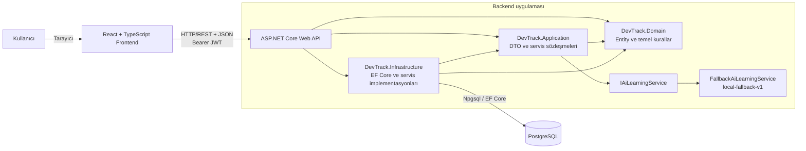
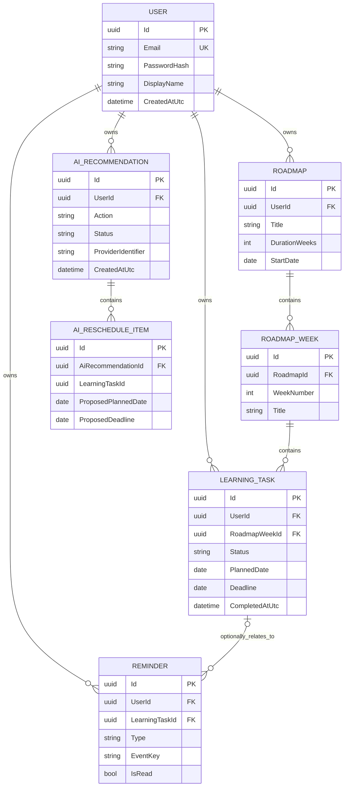
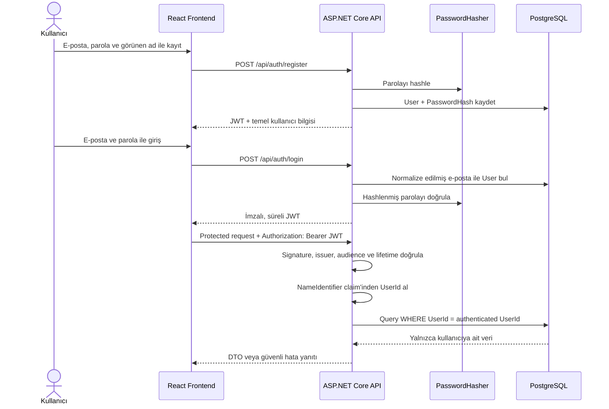

# DevTrack AI — Teknik Tasarım ve Mimari

## Dokümanın Amacı

Bu doküman DevTrack AI MVP'nin teknik yapısını, katmanların görevlerini, veri modelini ve önemli çalışma akışlarını açıklar. İçerik mevcut kaynak kod, EF Core modeli, migration'lar, frontend klasörleri ve otomatik testlerden doğrulanmıştır.

## 1. Mimariye Genel Bakış

DevTrack AI, tek uygulama yaklaşımıyla geliştirilmiş bir web uygulamasıdır. Kullanıcı arayüzü React ve TypeScript ile hazırlanmıştır. Frontend, HTTP/REST üzerinden ASP.NET Core Web API ile haberleşir. API, uygulama kurallarını uygular ve Entity Framework Core ile PostgreSQL veritabanına erişir.

Sistem dört temel çalışma parçasından oluşur:

- **React frontend:** Kullanıcı ekranlarını, route'ları, formları ve istemci oturumunu yönetir.
- **ASP.NET Core Web API:** Authentication, authorization, validation, iş akışları ve veri erişimini yönetir.
- **PostgreSQL:** Kullanıcı, roadmap, görev, reminder ve AI traceability verilerini kalıcı olarak saklar.
- **`local-fallback-v1`:** Backend içinde çalışan, dış servise bağlanmadan görev verilerinden deterministik öneri üreten AI service implementasyonudur.

Frontend ile backend JSON kullanan HTTP endpoint'leri üzerinden iletişim kurar. Bu MVP'de ayrı microservice, message queue, distributed cache veya harici AI servisi yoktur.

## 2. Sistem Mimarisi



API projesi uygulamanın composition root noktasıdır. Dependency injection kayıtları, JWT, CORS, DbContext ve AI provider seçimi `Program.cs` içinde yapılır. Mevcut AI provider `IAiLearningService` için scoped olarak kaydedilen `FallbackAiLearningService` sınıfıdır.

## 3. Backend Katmanları

### DevTrack.Api

HTTP sınırıdır. Controller'lar request alır, authenticated user claim'ini okur, validation ve ownership kontrollerini yapar, Entity Framework Core işlemlerini çağırır ve DTO döndürür. JWT Bearer yapılandırması, CORS policy, Swagger, global exception handling ve `/health` endpoint'i bu projededir.

`ApiControllerBase`, bütün controller'lar için `api/[controller]` route temelini ve JWT `NameIdentifier` claim'inden üretilen `UserId` özelliğini sağlar.

### DevTrack.Application

API ile diğer katmanlar arasındaki veri sözleşmelerini içerir. Register, login, roadmap, week, task, dashboard, reminder ve AI request/response DTO'ları burada tanımlıdır. `IAiLearningService` abstraction'ı ve entity-to-DTO mapping yardımcıları da bu katmandadır.

`Mapping.Percent`, boş listede sıfır dönen ve sonucu bir ondalık basamağa yuvarlayan ortak progress hesabını sağlar.

### DevTrack.Domain

Temel entity ve enum tanımlarını içerir. `User`, `Roadmap`, `RoadmapWeek`, `LearningTask`, `Reminder`, `AiRecommendation` ve `AiRescheduleItem` bu projededir. `LearningTask.IsOverdue`, tamamlanan bir görevi overdue saymayan temel domain kuralını uygular.

### DevTrack.Infrastructure

PostgreSQL ve dış implementasyon ayrıntılarını içerir. `DevTrackDbContext`, EF Core ilişkilerini, unique index'leri, enum conversion'larını ve delete davranışlarını tanımlar. Migration'lar, design-time DbContext factory ve `local-fallback-v1` implementasyonu bu projededir.

### DevTrack.Tests

xUnit tabanlı backend test projesidir. API testleri `WebApplicationFactory<Program>` ile gerçek HTTP pipeline'ını çalıştırır; PostgreSQL yerine test başına benzersiz isimli EF Core InMemory database kullanır. Business-rule testleri domain ve fallback service davranışlarını doğrudan sınar.

## 4. Frontend Mimarisi

Frontend, Vite ile oluşturulmuş React/TypeScript single-page application yapısındadır.

| Bölüm | Sorumluluk |
|---|---|
| `src/pages` | Login/register, dashboard, today/week, roadmaps, roadmap detail, notifications ve AI ekranlarını içerir. API state ve sayfa düzeyindeki işlemleri yönetir. |
| `src/components` | Responsive `Layout`, görev kartı/formu, modal, progress, loading, error ve empty state gibi tekrar kullanılabilir parçaları içerir. |
| `src/context` | `AuthProvider` ile kullanıcı ve authentication state'ini sağlar. JWT ve temel kullanıcı bilgisi local storage ile ilişkilendirilir. |
| `src/lib/api.ts` | Configurable API base URL, JSON header, Bearer token, `401` session temizleme ve backend hata mesajlarını işleyen ortak API client'tır. |
| `src/lib/format.ts` | Tarihleri ve backend enum değerlerini Türkçe presentation metinlerine dönüştürür. |
| `src/types.ts` | Backend DTO'larına karşılık gelen TypeScript tiplerini tanımlar. |
| `src/App.tsx` | React Router route tablosunu ve protected route sınırını tanımlar. |

Public route'lar `/login` ve `/register` adresleridir. Dashboard (`/`), `/today`, `/week`, `/roadmaps`, `/roadmaps/:id`, `/ai` ve `/notifications` protected layout altındadır. JWT yoksa kullanıcı login sayfasına yönlendirilir. Bu frontend kontrolü yalnızca kullanıcı deneyimini düzenler; gerçek authorization backend tarafından yapılır.

Frontend temel validation ile hızlı geri bildirim verir, ancak backend kurallarını güvenlik amacıyla tekrar uygulamaz. Backend source of truth olarak kalır.

## 5. Domain Modeli

### Entity'ler

1. **User:** Benzersiz e-posta, password hash, görünen ad ve oluşturulma zamanını tutar.
2. **Roadmap:** Kullanıcının öğrenme planıdır; başlık, açıklama, hafta süresi ve başlangıç tarihi içerir.
3. **RoadmapWeek:** Bir roadmap içindeki numaralı haftadır ve görevleri gruplar.
4. **LearningTask:** Tür, durum, öncelik, planlanan tarih, deadline, tahmini süre, completion zamanı, kaynak URL, week ve user ilişkisini tutar.
5. **Reminder:** Due-today veya overdue mesajını, read state'i, event key'i ve ilişkili task bilgisini tutar.
6. **AiRecommendation:** AI action, status, özet, provider identifier, oluşturulma zamanı ve kullanıcı bilgisini tutan traceability kaydıdır.
7. **AiRescheduleItem:** Bir reschedule recommendation içindeki task ID, önerilen tarihler ve gerekçeyi saklar.

### ER diyagramı



`AiRescheduleItem.LearningTaskId` görev kimliğini taşır; mevcut EF modelinde bu alan için `LearningTask` navigation veya database foreign key ilişkisi tanımlı değildir. Bu nedenle ER diyagramında `AiRescheduleItem` ile `LearningTask` arasında fiziksel ilişki çizilmemiştir. Backend apply sırasında task referansını kullanıcı ve öneri bağlamında doğrular.

## 6. Veritabanı Tasarımı

Runtime veritabanı PostgreSQL'dir. EF Core, Npgsql provider aracılığıyla tablo ve sorguları yönetir. Entity enum'ları veritabanında okunabilir string değerler olarak saklanır.

Mevcut migration geçmişi:

| Migration | Amaç |
|---|---|
| `20260817021316_InitialCreate` | User, roadmap, week, learning task ve ilk reminder veri modelinin temel tablolarını oluşturur. |
| `20260817022717_Phase2BackendMvp` | AI recommendation/reschedule tablolarını ve Phase 2 reminder model değişikliklerini ekler. |

Önemli veri modeli kararları:

- `User.Email` unique index'e ve 254 karakter sınırına sahiptir.
- `(RoadmapId, WeekNumber)` unique index'i aynı roadmap'te tekrar eden hafta numarasını engeller.
- `(UserId, EventKey)` unique index'i duplicate reminder'a karşı veritabanı seviyesinde ek koruma sağlar.
- User → Roadmap → RoadmapWeek → LearningTask zinciri ilgili ilişkilerde cascade delete kullanır.
- LearningTask → Reminder ilişkisi cascade delete kullanır.
- User → Reminder, User → AiRecommendation ve AiRecommendation → AiRescheduleItem ilişkileri cascade delete kullanır.
- LearningTask → User ilişkisi `Restrict` delete davranışındadır. Böylece task mevcutken user silme zincirinin etkisi açıkça yönetilmelidir.
- EF CLI işlemlerinde design-time factory, `ConnectionStrings__DevTrack` environment variable'ını zorunlu tutar.

## 7. Authentication ve Authorization Akışı



Register sırasında e-posta normalize edilir ve password `PasswordHasher<User>` ile hash'lenir. Login, aynı hasher ile stored hash'i doğrular. JWT sekiz saatlik expiration ile oluşturulur; issuer, audience, lifetime ve signing key doğrulaması aktiftir. Clock skew bir dakikadır.

Protected controller'lar `[Authorize]` kullanır. Request body'dan `UserId` alınmaz. Roadmap, task, reminder ve AI recommendation doğrudan `UserId` ile; week ise bağlı roadmap'in `UserId` değeri üzerinden filtrelenir. Başka kullanıcıya ait ID çoğunlukla `404 Not Found` ile izole edilir.

## 8. API Tasarımı

API route'ları controller tabanlıdır ve JSON enum değerleri string olarak serileştirilir.

### Auth

| Method | Route | Amaç |
|---|---|---|
| POST | `/api/auth/register` | Yeni kullanıcı oluşturur ve JWT döndürür. |
| POST | `/api/auth/login` | Credentials doğrular ve JWT döndürür. |

Logout için backend endpoint'i yoktur; frontend local session bilgisini temizler.

### Roadmaps

| Method | Route | Amaç |
|---|---|---|
| GET | `/api/roadmaps` | Kullanıcının roadmap'lerini listeler. |
| GET | `/api/roadmaps/{id}` | Roadmap, weeks, tasks ve progress detayını döndürür. |
| POST | `/api/roadmaps` | Roadmap oluşturur. |
| PUT | `/api/roadmaps/{id}` | Roadmap'i günceller. |
| DELETE | `/api/roadmaps/{id}` | Roadmap'i ilişkileriyle siler. |

### Weeks

| Method | Route | Amaç |
|---|---|---|
| POST | `/api/roadmaps/{id}/weeks` | Roadmap'e week ekler. |
| PUT | `/api/weeks/{weekId}` | Week number/title günceller. |
| DELETE | `/api/weeks/{weekId}` | Week'i ilişkili tasks ile siler. |

### Tasks

| Method | Route | Amaç |
|---|---|---|
| GET | `/api/tasks?status=&roadmapId=&from=&to=` | Kullanıcının görevlerini optional filtrelerle listeler. |
| GET | `/api/tasks/{id}` | Tek görevi getirir. |
| GET | `/api/tasks/today` | Bugüne planlanan görevleri getirir. |
| GET | `/api/tasks/week` | İçinde bulunulan pazartesi–pazar aralığındaki görevleri getirir. |
| POST | `/api/weeks/{weekId}/tasks` | Week içine task ekler. |
| PUT | `/api/tasks/{id}` | Task alanlarını günceller. |
| PATCH | `/api/tasks/{id}/completion` | Boolean body ile completion durumunu değiştirir. |
| DELETE | `/api/tasks/{id}` | Task'ı siler. |

### Dashboard

| Method | Route | Amaç |
|---|---|---|
| GET | `/api/dashboard` | Today/week/overdue/recent/upcoming listeleri, sayaçlar, progress ve streak döndürür. |

### Reminders

| Method | Route | Amaç |
|---|---|---|
| GET | `/api/reminders?unreadOnly=true|false` | Tüm veya okunmamış reminder'ları listeler. |
| POST | `/api/reminders/generate` | Due-today/overdue görevlerden yeni reminder üretir. |
| PATCH | `/api/reminders/{id}/read` | Kullanıcının reminder'ını read yapar. |

### AI

| Method | Route | Amaç |
|---|---|---|
| POST | `/api/ai/today` | Bugünkü çalışma önerisini üretir. |
| POST | `/api/ai/reschedule` | Incomplete gecikmiş işler için proposal üretir. |
| POST | `/api/ai/weekly-summary` | Haftalık progress özeti üretir. |
| POST | `/api/ai/next-task` | Sonraki öğrenme görevini önerir. |
| POST | `/api/ai/falling-behind` | Geride kalma göstergelerini açıklar. |
| POST | `/api/ai/suggest` | Body içindeki `AiActionType` için ortak suggestion girişi sağlar. |
| POST | `/api/ai/recommendations/{recommendationId}/apply-reschedule` | Seçilen proposal items için task tarihlerini doğrulayıp uygular. |

Ek olarak `GET /health` authentication gerektirmeden `{ "status": "healthy" }` döndürür. Swagger yalnızca Development environment'ta açılır.

## 9. AI Assistant Mimarisi

`IAiLearningService`, AI üretim ayrıntısını API controller'dan ayıran küçük bir abstraction'dır. Girdi olarak `AiLearningContext`, action type ve cancellation token alır; yapılandırılmış `AiProviderResult` döndürür.

Mevcut tek implementasyon `FallbackAiLearningService` ve provider identifier `local-fallback-v1` değeridir. Harici LLM, network tabanlı model veya AI API key bulunmaz. Fallback service:

- Authenticated kullanıcının incomplete/completed task DTO'larını kullanır.
- Planned date, deadline, overdue, priority ve estimated duration değerlerine göre sıralama ve özet üretir.
- Beş action için başlık, özet ve adımlardan oluşan structured response döndürür.
- Reschedule action için task ID, task title, proposed planned date, optional proposed deadline ve reason içeren structured proposal oluşturur.

API; boş summary/provider, null collection, kullanıcı context'inde olmayan task ID, geçmiş proposed planned date, deadline sırası ve yanlış action için proposal üretilmesi gibi durumları doğrular. Geçerli sonuç için `AiRecommendation` ve varsa `AiRescheduleItem` kayıtları oluşturulur. Bu kayıtlar kullanıcı, action, zaman, status, summary ve provider identifier üzerinden temel traceability sağlar. Tam prompt içeriği saklanmaz.

## 10. AI Rescheduling Akışı

**AI suggests → Backend validates → User decides.**

```mermaid
sequenceDiagram
    actor K as Kullanıcı
    participant F as React AI ekranı
    participant A as AI Controller
    participant DB as PostgreSQL
    participant S as IAiLearningService
    participant L as local-fallback-v1

    K->>F: Yeniden planlama önerisi ister
    F->>A: POST /api/ai/reschedule + JWT
    A->>DB: Kullanıcının task ve roadmap context'ini oku
    A->>S: SuggestAsync(context, RescheduleUnfinished)
    S->>L: Fallback implementasyonunu çalıştır
    L-->>A: Structured proposal
    A->>A: Task ID, ownership ve tarihleri doğrula
    A->>DB: Recommendation ve proposal items kaydet
    A-->>F: Proposal response
    F-->>K: Eski/yeni tarihleri preview olarak göster
    K->>F: Kalemleri seç ve Öneriyi Uygula
    F->>A: POST apply-reschedule + selected task IDs
    A->>DB: Recommendation, status ve tasks oku
    A->>A: Ownership, membership, completion ve tarihleri yeniden doğrula
    A->>DB: Seçilen LearningTask tarihlerini güncelle; status=Applied
    A-->>F: Uygulanan görev sayısı
```

İlk AI çağrısı görev tarihlerini değiştirmez. Recommendation ve proposal items traceability için kaydedilir; `LearningTask.PlannedDate` ve `Deadline` yalnızca apply endpoint'i başarıyla tamamlanırsa güncellenir. Completed task yeniden planlanamaz, kullanıcı başka kullanıcının recommendation'ını uygulayamaz ve `Applied` durumundaki recommendation ikinci kez uygulanamaz.

## 11. Reminder Tasarımı

Reminder üretimi kullanıcı tarafından `POST /api/reminders/generate` çağrısıyla başlatılır; background scheduler yoktur. Backend authenticated kullanıcıya ait ve status'u `Completed` olmayan görevleri inceler.

Bir görev şu durumlarda reminder adayıdır:

- `PlannedDate` bugünse,
- `Deadline` bugünse veya
- `Deadline` bugünden önceyse.

Deadline geçmişse reminder tipi `Overdue`, diğer adaylarda `DueToday` olur. Event key `${Type}:${TaskId}` biçimindedir. Backend mevcut event key'leri kontrol eder; ayrıca `(UserId, EventKey)` unique index'i yarış veya uygulama hatasına karşı database-level duplicate prevention sağlar.

Reminder listesi `CreatedAtUtc` azalan sırada döner ve `unreadOnly` filtresini destekler. Read işlemi yalnızca reminder sahibine açıktır. Task silinirse task'a bağlı reminder cascade silinir.

## 12. Dashboard ve Progress Hesaplama

Dashboard yalnızca authenticated kullanıcının bütün learning task kayıtlarını belleğe alarak özet üretir:

- **Today:** `PlannedDate == UTC today`.
- **This week:** UTC today'nin bulunduğu pazartesi–pazar aralığı.
- **Overdue:** Status completed değil ve `Deadline < today`.
- **Recently completed:** Completion timestamp'e göre azalan ilk beş completed task.
- **Upcoming deadlines:** Completed olmayan, deadline bugün veya daha sonra olan ve deadline'a göre sıralanan ilk beş task.
- **Completed/remaining:** Completed sayısı ve toplamdan kalan sayı.
- **Overall progress:** `completed / total * 100`; task yoksa 0, sonuç bir ondalık basamağa yuvarlanır.
- **Roadmap progress:** Roadmap'in bütün week task'ları üzerinden aynı formül.
- **Week progress:** Yalnızca ilgili week task'ları üzerinden aynı formül.
- **Learning streak:** `CompletedAtUtc` değerlerinin farklı UTC günleri alınır. Bugün completion varsa bugünden, yoksa dünden başlayarak kesintisiz geriye sayılır.

Frontend dashboard haftalık progress bar değerini `thisWeek` listesindeki completed görevlerin oranından hesaplar. API ayrıca genel progress değerini doğrudan döndürür.

## 13. Configuration ve Secret Management

Backend ASP.NET Core configuration sistemini kullanır:

- `ConnectionStrings__DevTrack`: PostgreSQL connection string.
- `Jwt__Key`: En az 32 byte JWT signing key.
- `Jwt__Issuer` ve `Jwt__Audience`: Token üretim/doğrulama değerleri.
- `Cors__AllowedOrigins__0` veya `FrontendUrl`: İzin verilen frontend origin'i.
- `ASPNETCORE_URLS`: API listen address/port.

Frontend `VITE_API_BASE_URL` değerini kullanır ve yoksa development için `http://localhost:5000` fallback'ine sahiptir. Kök `.env.example` ve `frontend/.env.example` yalnızca placeholder değerler sunar; gerçek secret içermez. Uygulama `.env` dosyasını kendi başına yüklemez, bu nedenle backend değişkenleri shell veya başka ASP.NET configuration kaynağıyla verilmelidir.

`.gitignore`; `.env`, `.env.*`, local appsettings, secret dosyaları, `bin`, `obj`, test/coverage çıktıları, `node_modules` ve `dist` gibi dosyaları dışlar. `.env.example` özellikle commit edilebilir örnek olarak hariç tutulmuştur.

CORS policy `AllowAnyOrigin` kullanmaz. Development configuration `http://localhost:5173` origin'ine; `Content-Type` ve `Authorization` header'larına; GET, POST, PUT, PATCH, DELETE ve OPTIONS method'larına izin verir.

## 14. Error Handling ve Validation

### Backend

- `[ApiController]` ve DataAnnotations required, range, max length, email ve URL gibi temel request validation'larını uygular.
- Task controller planned/deadline sırasını ve URL scheme'ini ayrıca doğrular.
- Roadmap/week controller duration ve tekrar eden week number kurallarını kontrol eder.
- Ownership dışındaki kaynaklar çoğunlukla `404` döndürür.
- Invalid credentials `401`, duplicate account/week `409`, invalid business input `400` olarak ele alınır.
- AI malformed output `502`, timeout `504`, genel provider failure `503` ile raporlanır.
- `AddProblemDetails` ve exception handler normal API yanıtlarında stack trace açığa çıkmasını engeller.
- AI failure log mesajı prompt content kaydetmez.

### Frontend

- Ortak API client network failure için Türkçe bağlantı mesajı üretir.
- `401` geldiğinde JWT ve kullanıcı bilgisi temizlenir; kullanıcı login'e yönlendirilir.
- Backend `ProblemDetails.title` ve validation `errors` alanları mümkün olduğunda kullanıcıya gösterilir.
- Formlar required alanlar, minimum parola, tarih sırası ve URL input gibi temel client-side kontrol sağlar.
- Sayfalarda loading, error ve empty states bulunur; destructive roadmap/week/task işlemlerinde confirmation kullanılır.
- Backend validation source of truth olmaya devam eder.

## 15. Test Mimarisi

Mevcut backend suite toplam **19 test** çalıştırır. Testlerin kapsadığı davranışlar kategorik olarak şöyledir:

- **Authentication ve CORS:** Başarılı registration, invalid login ve configured frontend origin için register OPTIONS preflight.
- **Week/task validation ve ownership:** Roadmap duration dışı week, cross-user week update, cross-user task read.
- **Task lifecycle:** Completion timestamp oluşturma/temizleme ve completed task'ın overdue olmaması.
- **Reminder:** Cross-user mark-read engeli, duplicate üretmeme ve Türkçe overdue reminder çıktısı.
- **Progress:** İki görevden biri completed olduğunda roadmap ve week progress değerinin yüzde 50 olması.
- **Fallback AI:** Beş action'ın doğru Türkçe başlığı, boş olmayan summary'si, provider identifier ve yalnızca reschedule action'da proposal üretimi.
- **AI apply security:** Completed task reschedule engeli, başka kullanıcının recommendation'ını uygulayamama ve invalid recommendation/task reference reddi.
- **AI provider validation:** Context dışında task ID döndüren provider sonucunun `502 Bad Gateway` ile reddedilmesi.
- **Backend foundation testleri:** Registration/login dışında mevcut suite içinde task create/update ve ownership gibi HTTP akışları test yardımcıları üzerinden kullanılır.

Test host gerçek ASP.NET Core middleware/controller pipeline'ını kullanır; fakat `DevTrackDbContext`, EF Core InMemory provider ile değiştirilir. Bu nedenle testler yerel PostgreSQL verisine dokunmaz. Gerçek PostgreSQL'e karşı otomatik integration test suite bulunmamaktadır.

Frontend'de component veya end-to-end test framework'ü yoktur. Mevcut otomatik kalite kontrolleri Oxlint ve TypeScript/Vite production build'dir.

## 16. Güvenlik Kararları

- Parolalar `PasswordHasher<User>` ile hash'lenir; düz metin saklanmaz.
- JWT signature, issuer, audience, lifetime ve signing key doğrulaması aktiftir.
- `UserId` request body'dan alınmaz; doğrulanmış JWT claim'inden elde edilir.
- Bütün protected kaynak sorgularında ownership filtresi uygulanır.
- Cross-user ID manipulation özel veri varlığını açığa çıkarmayacak biçimde engellenir.
- CORS izinleri belirli origin/header/method listesiyle sınırlandırılır.
- Connection string ve JWT key kaynak kodda hard-code edilmez.
- AI output trusted input sayılmaz; structured references ve tarihler backend'de doğrulanır.
- AI task değişikliği yalnızca explicit apply action sonrasında gerçekleşir.
- Hassas prompt content, JWT, password veya credential loglanmaz.

## 17. Teknik Kısıtlar ve Gelecekte Geliştirilebilecek Alanlar

Mevcut MVP'nin doğrulanmış teknik sınırları:

- AI provider deterministik `local-fallback-v1` ile sınırlıdır; harici LLM yoktur.
- Reminder yalnızca manuel API/UI çağrısıyla üretilir; background processing yoktur.
- Native push, e-posta veya takvim entegrasyonu yoktur.
- Tarih tabanlı backend hesapları UTC gününü kullanır; kullanıcı timezone tercihi modeli yoktur.
- Backend controller'ları iş akışlarının önemli bölümünü doğrudan içerir. MVP boyutunda anlaşılır olsa da proje ciddi biçimde büyürse application service ayrımı değerlendirilebilir.
- Dashboard bütün kullanıcı task'larını belleğe alıp hesap yapar. Bireysel MVP için uygundur; çok büyük veri hacminde database-side aggregate sorguları gerekebilir.
- AI reschedule item'ın task referansı için fiziksel foreign key yoktur; doğrulama application flow içinde yapılır.
- Backend testleri PostgreSQL davranışını otomatik sınamaz.
- Frontend için component/E2E otomasyonu yoktur.
- Password reset, email verification ve token refresh mekanizması yoktur.

Bu alanlar gelecekte geliştirilebilir; ancak mevcut single-application yapısı ve güvenlik sınırları somut bir ihtiyaç olmadan değiştirilmemelidir.
